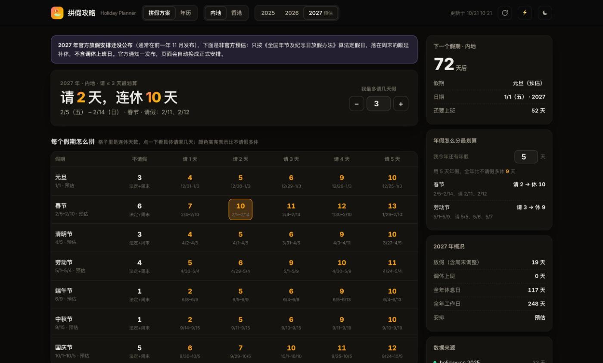
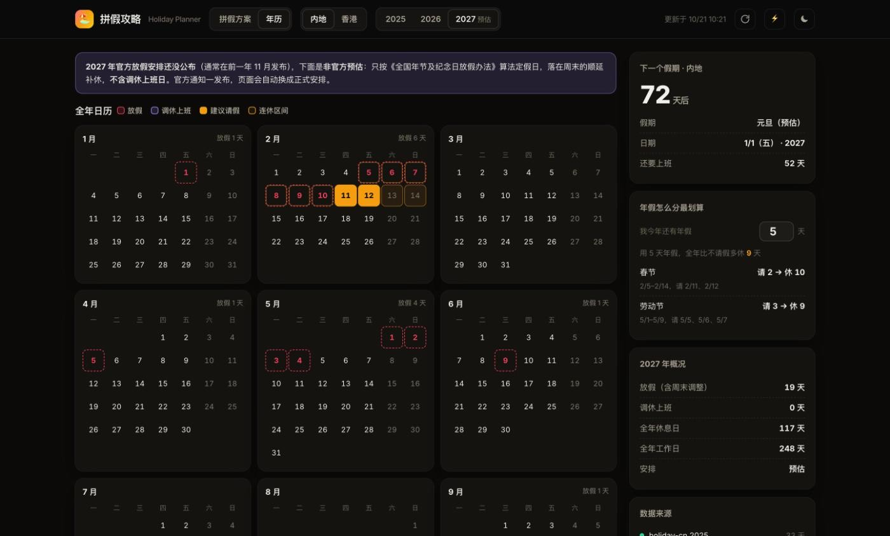

# 🏖️ Holiday Planner · 拼假攻略

> 内地 / 香港全年放假与调休日历，自动算出「请 N 天连休 M 天」的最优拼假方案

**🌐 在线访问：[https://climb0516.github.io/holiday-planner/](https://climb0516.github.io/holiday-planner/)**

---

## 截图

**拼假方案**：每个假期请 0～5 天分别能连休几天，全年最划算的方案（首页前 6 个，「查看更多」看全部），点选后看具体请哪几天



**年历**：放假、调休上班、建议请假、连休区间一目了然；预估的假期用虚线框标出



---

## 功能

- **拼假方案**（首页）
  - 输入「我最多请几天假」，顶部直接给出全年最长的连休方案
  - **每个假期怎么拼**：每个法定假期 × 请 0～5 天的连休天数矩阵；多请一天但连休没变长的格子标「多请没用」，已过去的假期变灰
  - **全年最划算方案**：首页列前 6 个（`HOME_PLANS`），「查看更多」列表页显示全部；请假不超过 N 天、互不重叠、按连休天数排序，附「1 换 X」效率和每天休 / 班 / 请假色条。只统计中间「桥接」用的请假，首尾那种 1 天换 1 天的不算
  - 选中方案后：复制文字（发给家人 / 同事）、在年历中查看、**导出 .ics 加到手机日历**（连休区间 + 每个请假日各一条）
- **年历**：12 个月的月历，标出放假、调休上班（带「班」字）、建议请假日和连休区间，今天有描边
- **内地 / 香港切换**：内地含调休上班日；香港没有调休，按公众假期 + 周六日计算
- **2027 预估**：国务院通知发布前（通常在前一年 11 月），按《全国年节及纪念日放假办法》推算法定假日，落在周末的顺延补休，页面醒目标注「非官方预估、不含调休」。官方安排抓到后自动替换，并在顶部高亮「已公布」14 天
- 右侧挂件：
  - 距下一个假期几天、还要上几天班
  - **年假怎么分最划算**：填剩余年假天数，按分组背包算出分到哪几个假期、全年能多休几天
  - 年度概况（放假 / 调休 / 休息日 / 工作日）、来源状态
- 默认年份：当年剩下的法定假期已经过完时（比如 10 月之后），自动打开明年
- 右上角：↻ 重新读取数据，⚡ 跳转 GitHub Actions 手动触发抓取，☾ 深浅色；手机适配
- 请假天数、年假余额、地区等设置只保存在本机浏览器（localStorage）

---

## 技术架构

```
GitHub Actions（触发：每 6 小时一次 / 手动 dispatch / push 修改 scraper.py 或 workflow）
  ↓ python scraper.py（Python 3.12，只用标准库）
  ↓ holiday-cn 抓去年～明年三年内地安排（jsDelivr → raw.githubusercontent 双镜像）
  ↓ 某年官方未公布 → cn_estimate() 用内置农历表生成预估版
  ↓ 香港 1823 公众假期 JSON
  ↓ 记录每年第一次抓到官方安排的时间（announce），算 summary 摘要
  ↓ 写入 data.json（updated 每次都变 = 心跳）→ git commit → push
       ↓
GitHub Pages（index.html 读取 data.json，拼假计算全部在前端完成）
  ↓ 首页两个视图：拼假方案 / 年历
  ↓ kit 详情抽屉（#/item/<类型>/<id>）+ 列表页（#/list/plans）
```

---

## 数据来源

| 来源 | 方式 | 每次条数 / 范围 | 备注 |
|---|---|---|---|
| [holiday-cn](https://github.com/NateScarlet/holiday-cn) | 接口（GitHub 上的年度 JSON 文件，先走 jsDelivr，失败再走 raw.githubusercontent） | 每次抓去年、今年、明年 3 个年份；每年几十条放假 / 调休日（如 2026 年 39 条） | 第三方解析国务院通知，通知发布后通常当天更新；`days[].isOffDay` 为 false 即调休上班 |
| [香港 1823 公众假期](https://www.1823.gov.hk/common/ical/sc.json) | 接口（iCal 格式的 JSON） | 一次返回全部年份，按年份分组（当前约 51 条，通常能查到明年） | 政府开放数据，只有假期名和日期 |
| 内置农历表 `LUNAR` | 代码内常量 | 2027、2028 两年的除夕 / 清明 / 端午 / 中秋公历日期 | 只用于官方未公布时的预估；之后的年份需要手动补 |

**配置位置**：`scraper.py` 顶部
- `CN_MIRRORS`：holiday-cn 镜像地址模板（`{y}` 换成年份），按顺序尝试
- `HK_URL`：香港 1823 JSON 地址
- `LUNAR`：预估用的农历节日公历日期（春节填除夕）
- 抓取年份范围写在 `main()`：`range(now.year - 1, now.year + 2)`

**增删来源**：新增地区时写一个返回 `{年份: [{date, name}]}` 的函数，在 `main()` 里用 `run("显示名", fn, count=...)` 调用并放进 `data`；前端在 `buildDayMap()` 里加对应分支。预估要覆盖更多年份，就往 `LUNAR` 里加一年。

**限制**：
- 预估版不含调休，官方安排可能把连休拉长（例如国庆通常连休 7～8 天），以官方通知为准
- 按每周五天工作制计算；如果你周六要上班，实际请假天数会更多
- holiday-cn 由第三方维护，取不到时沿用上一次的数据并标「旧数据」（`stale`）

---

## 数据处理规则

**内地 `cn_year(y)`**：依次请求 `CN_MIRRORS`，把 `isOffDay` 转成 `off`，保留 `papers`（国务院通知链接）；全部镜像失败才抛错。

**预估版 `cn_estimate(y)`**：按《全国年节及纪念日放假办法》（2025 年起施行）列出法定假日，共 13 天：
- 元旦 1/1；春节 = 除夕起 4 天（除夕～初三）；清明 1 天；劳动节 5/1、5/2；端午 1 天；中秋 1 天；国庆 10/1～10/3
- 法定假日落在周六日时，往后找第一个「不是周末、也没被占用」的日子补休，标 `comp: true`
- 不生成调休上班日；`LUNAR` 里没有的年份返回 None（不出预估）

**年份合并 `main()`**
- 抓到官方安排（`days` 非空）→ `official: true, stale: false`
- 抓取失败但旧数据是官方的 → 沿用旧数据并标 `stale: true`
- 抓到但为空（还没公布）→ 用预估版，`official: false`
- `announce`：今年和明年第一次抓到官方安排时记录 `first_seen`；如果上一次还是预估版，`fresh: true`（前端据此在 14 天内显示「已公布」横幅）

**香港 `hk_all()`**：遍历 `vcalendar[0].vevent`，`dtstart` 的 `YYYYMMDD` 转成日期，按年份分组排序；为空时报错，失败沿用旧数据。

**摘要 `summarize(cn, today, max_leave=3)`**（给 pages-dashboard 用，只算内地）
- `next`：今天之后第一个放假日，距今天数 `days`、期间工作日数 `workdays`、是否预估 `est`
- 计划年份：今年还有放假日就算今年，否则算明年；在 [1/1 − 20 天, 12/31 + 20 天] 范围内找连休
- 只从「休息日且前一天是工作日」起，向后延伸到请假不超过 3 天，再把末尾的工作日退掉（首尾 1 换 1 的请假不算）；长度 < 3 或不含法定假日的丢掉
- 按（连休天数降序、请假天数升序、开始日期）排序，贪心取互不重叠的前 5 个

**前端拼假算法（index.html）**
- `buildDayMap()`：内地用 holiday-cn 的 `off`（true 放假、false 调休上班），其余按周末；香港 = 公众假期 + 周六日
- `analyse(region, y)`：生成当年前后各多 20 天的逐日列表（休 / 班），用前缀和 `work(s, e)` 求任意区间的工作日数（= 要请的假）；节日分组内地按名称、香港按相邻（间隔 ≤ 3 天）归并，再用 `hkGroup()` 统一名称（农历新年、复活节、圣诞节…）
- `maxEnd(A, s, n)`：从 s 起请假不超过 n 天能延伸到的最远日
- `bestForGroup(A, g, k)`：某个假期请 k 天的最长连休，起点在假期前 30 天内、必须是最左端、区间必须包含该假期至少一天；同长度取请假少的
- `topPlans(A, n, futureOnly, limit)`：全年请 ≤ n 天的连休，规则同上面的摘要（只算中间桥接的请假，长度 ≥ 3），首页方案卡片只显示前 6 个（`HOME_PLANS`），「全部 N 个方案 →」进列表页看全部
- 矩阵：每个假期 × 请 0～5 天；请 k 天和 k−1 天一样长时标「多请没用」；效率「1 换 X」= 连休天数 / 请假天数
- `allocate(A, B, futureOnly)`：年假分配是分组背包——每个假期选请 k 天（k ≤ min(B, 10)），收益 = 连休天数 − 不请假时的连休天数，总请假 ≤ B，最大化收益
- 请假天数输入范围 0～15（`MAX_N`）
- 默认年份：今年剩余没有放假日、且有明年数据时，默认打开明年

---

## 数据结构

所有数据都在一个 `data.json` 里（没有其他 json 或快照文件）。

```
{
  "updated": "2026-10-22T13:01:10+08:00",       // 北京时间，每次运行都变（心跳）
  "cn": {                                         // 去年～明年
    "2026": { "papers": ["https://www.gov.cn/..."], "official": true, "stale": false,
              "days": [ { "date": "2026-10-10", "name": "国庆节", "off": false } ] },      // off=false 为调休上班
    "2027": { "papers": [], "official": false, "stale": false,
              "days": [ { "date": "2027-10-04", "name": "国庆节", "off": true, "comp": true } ] }  // comp=周末顺延补休（预估）
  },
  "hk": { "2027": [ { "date": "2027-02-06", "name": "农历年初一" } ] },
  "announce": { "2026": { "first_seen": "2026-10-21T10:21:59+08:00", "fresh": false } },  // fresh=由预估转为官方
  "summary": {                                    // 给 pages-dashboard 的摘要（内地），字段只增不减
    "next": { "date": "2027-01-01", "name": "元旦", "days": 71, "workdays": 51, "est": true },
    "plan_year": 2027, "plan_official": false, "max_leave": 3,
    "top": [ { "from": "2027-02-05", "to": "2027-02-14", "len": 10, "used": 2,
               "leave": ["2027-02-11", "2027-02-12"], "names": ["春节"] } ]        // 最多 5 个
  },
  "sources": [ { "name": "holiday-cn 2027", "ok": true, "count": 0, "updated": "...", "error?": "..." } ]
}
```

---

## 前端

单页 `index.html`，原生 JS，无构建；`fetch('data.json?t=<时间戳>', { cache: 'no-store' })` 读取数据。

**kit 详情抽屉 + 列表页**（内联在页面里的通用组件 `KIT`）

列表页是新开的一层：从右侧滑入盖在首页上，返回时滑走；首页一直在底下不动，滚动位置不变。在列表里点开的详情盖在这一层之上；直接打开列表链接时不播进场动画；安卓手机可从左边缘右滑返回（iOS 用系统自带手势）。
- 点击矩阵格、方案卡、年历日格等打开详情抽屉：电脑端从右侧滑出，手机端（≤ 760px）从底部升起；`Esc`、点遮罩或浏览器返回关闭
- 详情地址 `#/item/<类型>/<id>`，列表页地址 `#/list/<key>`，都写进地址栏，分享链接可直接打开（数据加载完后 `KIT.boot()` 弹出详情）
- 链接里的条目在当前数据中找不到（已过期 / 旧链接 / 年份已不在数据范围）时，弹出「这条内容已不在当前数据里」提示，并给「回到首页」按钮

本项目的条目类型：

| 类型 | id | 内容 |
|---|---|---|
| `plan` | `<地区>-<开始日>-<结束日>`，如 `cn-2027-02-05-2027-02-14` | 一个拼假方案：逐日条、请假日、其中的调休上班日、同一假期的其它拼法；按钮：复制文字、在年历中查看、加到手机日历（.ics） |
| `day` | `<地区>-<日期>`，如 `cn-2027-01-01` | 某个放假日 / 调休上班日所属假期：整个假期安排、不请假连休、怎么拼、当年其它假期；国务院通知 / 1823 外链 |
| `year` | `<地区>-<年份>`，如 `cn-2027` | 全年放假安排表（各假期放假日、天数、调休上班）；预估年份附说明 |

地区取值：`cn`（内地）、`hk`（香港）。

本项目的列表页：

| key | 内容 | 参数 |
|---|---|---|
| `plans` | 当前年份 / 地区的全部互不重叠方案（不限 10 条） | `?n=0~15` 请假天数（chips 提供 0、1、2、3、4、5、6、8、10），`&sort=len / used / eff / date`（连休天数 / 请假天数少的在前 / 性价比 / 日期） |

列表页每页 30 条，「加载更多」追加 30 条。

**项目特有功能**
- 拼假方案 / 年历两个视图切换，内地 / 香港、年份切换（预估年份带「预估」小字）
- 横幅：官方安排刚公布（`announce.fresh` 且 14 天内）、当年未公布用预估、数据沿用旧版（`stale`）、香港无调休说明
- 导出 .ics：连休区间一条全天事件 + 每个请假日各一条
- 「只看今天之后」开关（仅当年生效）
- 右上角：↻ 重新读取数据，⚡ 跳转 GitHub Actions 的 scrape.yml 页面手动触发，☾ / ☀ 深浅色（默认跟随系统）
- 设置（视图、地区、请假天数、年假余额、只看今天之后、主题）保存在 `localStorage`，键前缀 `hp.`

---

## 本地运行

```
python3 scraper.py
python3 -m http.server 8799
# 打开 http://localhost:8799
```

- 依赖：Python 3（CI 用 3.12），只用标准库，无需 `pip install`
- 环境变量：无，不需要任何密钥
- 页面必须通过 HTTP 服务打开（直接双击 index.html 时 `fetch` 读不到 data.json）

---

## 自动更新机制

| 触发方式 | 时机 |
|---|---|
| GitHub Actions 定时任务（cron `17 */6 * * *`） | 每 6 小时一次，北京时间 02:17、08:17、14:17、20:17（官方通知发布后尽快换成正式安排） |
| push 到 main 分支 | 仅当改动了 `scraper.py` 或 `.github/workflows/scrape.yml` |
| GitHub Actions 手动 dispatch | 按需触发（页面右上角 ⚡ 直达） |

- workflow：`.github/workflows/scrape.yml`，`concurrency: scrape`（不取消进行中的任务），权限 `contents: write`
- 运行完执行 `git add data.json`，有变化才提交（提交信息 `data: update <北京时间>`），然后 `git pull --rebase` 再 push
- **心跳**：data.json 里的 `updated` 每次运行都会变，所以每次运行都有提交，仓库保持活跃
- GitHub 规定：仓库 60 天没有提交会自动停用定时任务；有了上面的心跳一般不会触发，若被停用需到 Actions 页面手动重新启用
