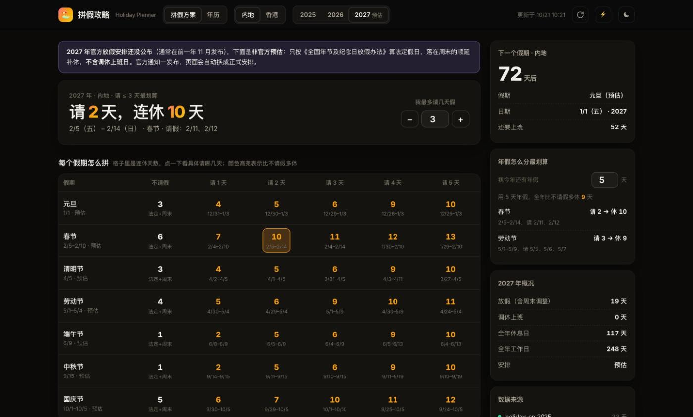
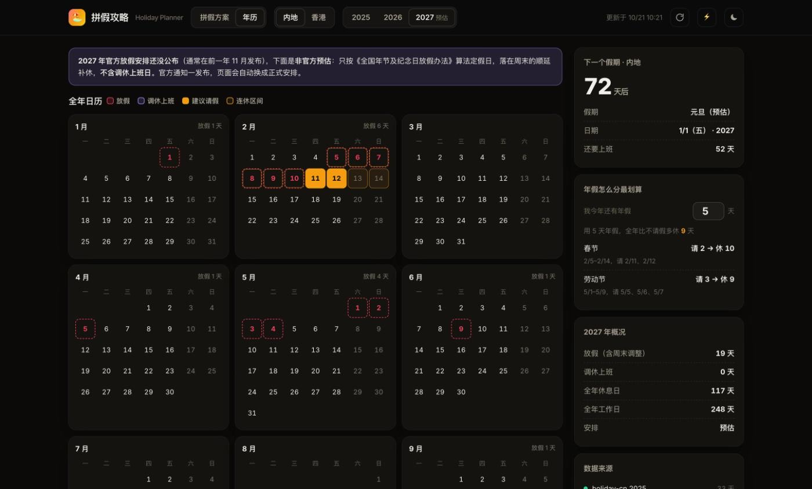

# 🏖️ Holiday Planner · 拼假攻略

> 内地 / 香港全年放假与调休日历，自动算出「请 N 天连休 M 天」的最优拼假方案

**🌐 在线访问：[https://climb0516.github.io/holiday-planner/](https://climb0516.github.io/holiday-planner/)**

---

## 截图

**拼假方案**：每个假期请 0～5 天分别能连休几天，全年最划算 Top 10，点选后看具体请哪几天



**年历**：放假、调休上班、建议请假、连休区间一目了然；预估的假期用虚线框标出



---

## 功能

- **拼假方案**（首页）
  - 输入「我最多请几天假」，顶部直接给出全年最长的连休方案
  - **每个假期怎么拼**：每个法定假期 × 请 0～5 天的连休天数矩阵；多请一天但连休没变长的格子标「多请没用」，已过去的假期变灰
  - **全年最划算 Top 10**：请假不超过 N 天、互不重叠、按连休天数排序，附「1 换 X」效率和每天休 / 班 / 请假色条。只统计中间「桥接」用的请假，首尾那种 1 天换 1 天的不算
  - 选中方案后：复制文字（发给家人 / 同事）、在年历中查看、**导出 .ics 加到手机日历**（连休区间 + 每个请假日各一条）
- **年历**：12 个月的月历，标出放假、调休上班（带「班」字）、建议请假日和连休区间，今天有描边
- **内地 / 香港切换**：内地含调休上班日；香港没有调休，按公众假期 + 周六日计算
- **2027 预估**：国务院通知发布前（通常在前一年 11 月），按《全国年节及纪念日放假办法》推算法定假日，落在周末的顺延补休，页面醒目标注「非官方预估、不含调休」。官方安排抓到后自动替换，并在顶部高亮「已公布」14 天
- 右侧挂件：
  - 距下一个假期几天、还要上几天班
  - **年假怎么分最划算**：填剩余年假天数，按分组背包算出分到哪几个假期、全年能多休几天
  - 年度概况（放假 / 调休 / 休息日 / 工作日）、来源状态
- 默认年份：当年剩下的法定假期已经过完时（比如 10 月之后），自动打开明年
- 右上角：↻ 重新读取数据，⚡ 跳转 GitHub Actions 手动触发抓取，☾ 深浅色；手机适配
- 请假天数、年假余额、地区等设置只保存在本机浏览器（localStorage）

---

## 数据来源

| 来源 | 内容 | 说明 |
|---|---|---|
| [holiday-cn](https://github.com/NateScarlet/holiday-cn)（jsDelivr / raw.githubusercontent 双镜像） | 内地每年放假日、调休上班日、国务院通知链接 | 自动解析国务院通知，通知发布后通常当天更新 |
| [香港 1823 公众假期](https://www.1823.gov.hk/common/ical/sc.json) | 香港公众假期（通常可查到明年） | 政府开放数据 |
| 内置农历表 | 2027、2028 年除夕 / 清明 / 端午 / 中秋的公历日期 | 只用于官方未公布时的预估 |

**限制**：
- 预估版不含调休，官方安排可能把连休拉长（例如国庆通常连休 7～8 天），以官方通知为准
- 按每周五天工作制计算；如果你周六要上班，实际请假天数会更多
- holiday-cn 由第三方维护，取不到时沿用上一次的数据并标「旧数据」

---

## 技术架构

```
GitHub Actions（每 6 小时 / 手动 / 修改爬虫后 push）
  ↓ python scraper.py（只用标准库）
  ↓ holiday-cn 去年～明年 + 香港 1823；明年未公布时生成预估版
  ↓ 记录每年第一次抓到官方安排的时间（announce），用于「刚公布」高亮
  ↓ 写入 data.json 并 commit（updated 每次都变 = 心跳，防止定时任务因 60 天不活跃被停用）
       ↓
GitHub Pages（index.html 读取同目录 data.json，拼假计算全部在前端完成）
```

拼假算法：把每天标成「休 / 班」，用前缀和算任意区间内的工作日数（= 要请的假），对每个起点求请假不超过 N 天能延伸到的最远日期；单个假期的方案要求区间至少包含该假期一天；年假分配是「每个假期选请几天」的分组背包，最大化比不请假多休的天数。

### data.json 结构

```
{
  "updated": "2026-10-21T10:21:59+08:00",
  "cn": {
    "2026": { "papers": ["https://www.gov.cn/..."], "official": true, "stale": false,
              "days": [ { "date": "2026-10-10", "name": "国庆节", "off": false } ] },   // off=false 为调休上班
    "2027": { "papers": [], "official": false, "stale": false,
              "days": [ { "date": "2027-10-04", "name": "国庆节", "off": true, "comp": true } ] }  // comp=周末顺延补休（预估）
  },
  "hk": { "2027": [ { "date": "2027-02-06", "name": "农历年初一" } ] },
  "announce": { "2026": { "first_seen": "2026-10-21T10:21:59+08:00", "fresh": false } },   // fresh=由预估转为官方
  "sources": [ { "name": "holiday-cn 2027", "ok": true, "count": 0, "updated": "..." } ]
}
```

---

## 本地预览

```
python3 scraper.py
python3 -m http.server 8799
# 打开 http://localhost:8799
```
